  

 

### 🧠 About Me
Computer Science Senior specializing in **Agentic AI Systems**, **RAG Architectures**, and **AI Security**. I build reliable, cloud-integrated LLM workflows and evaluate autonomous agents against adversarial attacks.

- 🔭 **Currently building:** Multi-Agent Cybersecurity Analysis System (Graduation Project)
- 🌱 **Developing:** Intelligent RAG backend for **Dawem** — a collaborative habit & study-planning platform
- 🏆 **Certified:** AWS Certified Machine Learning Engineer – Associate (`MLA-C02`) & Microsoft Fabric Data Engineer (`DP-700`)
- ⚡ **Vibe:** Late-night builds, autonomous agents, and a cat supervising the code.

---

### 🛠️ Featured Engineering Work

| Project | Engineering Focus & Tech Stack |
| :--- | :--- |
| **🤖 Multi-Agent Security Orchestrator** | Orchestrated multi-agent threat analysis pipeline built with **LangGraph**, **LangChain**, and **Groq (Llama 3.3 70B)**. |
| **📚 Dawem AI Engine** | RAG-based task generation and personalized study planning backend integrated with AWS cloud infrastructure. |
| **🧩 AI Browser & Bot Tooling** | Multi-tab Chrome Extension (**Gemini & Groq APIs**) and multimodal Python Telegram Bot supporting voice, vision, and automated workflows. |

---

### 🔨 Languages & Tools

#### AI, Agents & Data Science

  
  
  
  
  
  

#### Cloud, Systems & Web

  
  
  
  
  
  

---

### 📊 GitHub Activity

  
  

 

### 📫 Connect With Me

  
  

